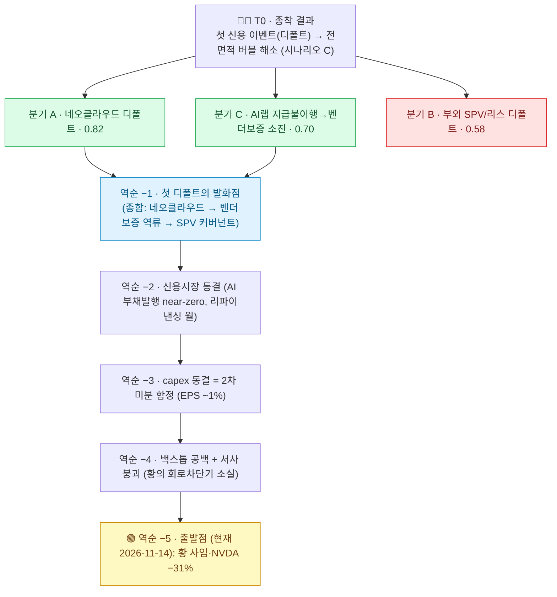

# 역순으로 되감은 붕괴: 신용 이벤트에서 오늘까지

## 이 리포트의 방법 (Graph of Thoughts · 백캐스트)

이 리포트는 앞선 「젠슨황 사임은 버블의 핀일 뿐이다」의 후속으로, **결과를 먼저 고정한 뒤 시간을 거꾸로 되감는 역시간순(backcasting) 추론**이다. 종착점 T0 — "AI 순환 금융 사슬에서 첫 신용 이벤트(디폴트)가 터져 전면적 버블 해소(시나리오 C)가 확정된 상태" — 를 **이미 일어난 일로 가정**하고, 각 단계마다 **"그 일이 벌어지려면 바로 직전에 무엇이 반드시 선행했어야 하는가"**를 물어 2026년 11월 14일 현재까지 거슬러 올라간다.

추론은 Graph of Thoughts로 구성했다. 첫 디폴트의 발화 지점에 대해 세 분기(네오클라우드 / 부외 SPV / AI랩 지급불이행)를 생성·채점한 뒤 가장 강한 둘을 하나로 종합했고(merge), 거기서부터 단일 역순 사슬을 뻗었다. 아래가 그 사고 그래프다. 화살표는 **시간이 아니라 추론의 방향**(위=종착 결과, 아래로 갈수록 과거의 선행 원인)이다.

핵심 전제: 앞 리포트의 판정("핀이 아니라 버블의 취약성이 결과를 정한다")을 그대로 상속한다. 따라서 이 역순 사슬은 **예언이 아니라, 시나리오 C가 성립하려면 반드시 채워져야 하는 "선행 조건들의 목록"**이다. 아래로 내려갈수록 현재에 가까워지고, 각 단계가 실제로 관측되는지가 곧 C의 실현 확률을 끌어올리는 체크리스트가 된다.

---

## T0 — 종착 결과 (고정): 첫 디폴트가 전면 해소로 전이됨

되감기의 출발점은 결과다. 순환 금융 사슬 어딘가에서 **실제 디폴트**가 발생하고, 그것이 심리 충격을 넘어 **기계적·시스템적 전이**로 번진 상태다 — 담보(GPU) 장부가 급락 → 추가 상각 → 강제 청산 → 상관 급등. 신용 스프레드가 더 이상 "기술 생태계 내부에 국한"되지 않고 투자등급(IG)·국채 시장으로 번지며, 주식시장 가치가 GDP의 240%(닷컴 정점 160%를 상회)에서 되돌려진다 ([NYT](https://www.nytimes.com/2026/11/06/opinion/nasdaq-tech-stocks-ai-bubble-dot-com-bust.html)). 소로스 8단계의 7→8단계(황혼기 → 자기강화적 붕괴)가 완성된 국면이며, 하락은 "짧고 폭력적"이다 ([Bian et al., NBER w25040](https://www.nber.org/system/files/working_papers/w25040/w25040.pdf)). 이 결과를 고정했으니, 질문은 하나뿐이다 — **그 직전에 무엇이 있었나.**

## 역순 −1 — 첫 디폴트의 발화점: 사슬의 가장 약한 고리

T0가 성립하려면 바로 직전에 **"실제 디폴트"라는 단일 사건**이 있어야 한다. 심리적 매도(시나리오 B)는 회복되지만, 레버리지 사슬의 현물 디폴트는 되돌릴 수 없다 — 이것이 B와 C를 가르는 분기점이다. 어디서 먼저 깨지는가에 대해 세 후보를 평가했다.

- **분기 A · 네오클라우드 디폴트 (채점 0.82, 최유력).** CoreWeave류 네오클라우드는 사슬에서 가장 레버리지가 높다 — 매출의 25% 이상이 부채상환에 묶이고, 소수 하이퍼스케일러 계약에 매출이 집중돼 **단일 계약의 취소·지연만으로 커버리지가 즉시 무너진다** ([I/O Fund](https://io-fund.com/ai-stocks/ai-debt-nears-500-billion-nvidia-oracle-coreweave)). 가장 먼저 터질 고리.
- **분기 C · AI랩 지급불이행 → 벤더 보증 소진 (0.70, 전이성 최대).** OpenAI류가 컴퓨트 약정을 못 지키면 엔비디아 최대 $100B·브로드컴 $42B 보증이 드로다운되며 **신용위험이 칩벤더로 역류**한다 ([Reuters](https://www.reuters.com/business/broadcom-lend-anthropic-up-42-billion-lease-its-chips-filing-says-2026-10-01/)). 다만 OpenAI가 최근 대형 라운드로 단기 유동성을 확보해 "첫 방아쇠"로서의 즉각성은 낮다.
- **분기 B · 부외 SPV/리스 디폴트 (0.58, 2순위).** 오라클의 $288B 미개시 리스와 칩 리스 SPV가 가동률 미달로 커버넌트를 위반하는 경로. 그러나 "미개시" 상태라 디폴트 시점이 더 멀고 불투명해, 첫 방아쇠보다는 **증폭기**에 가깝다.

**종합(현실적 경로):** 가장 약한 네오클라우드가 **먼저** 디폴트/구조조정에 들어가고, 이 1차 디폴트가 ① GPU 담보가치 급락과 추가 상각, ② 동일 구조에 노출된 AI랩의 지급 약정 불이행 위험 자극 → 벤더 보증 드로다운(신용위험의 칩벤더 역류), ③ 오라클 부외 리스 SPV의 커버넌트 재평가로 **동시다발 연쇄**한다. IMF가 지목한 14개 순환 구조가 위험 분산이 아니라 위험 전달 장치였음이 이 순간 드러난다 ([I/O Fund](https://io-fund.com/ai-stocks/ai-debt-nears-500-billion-nvidia-oracle-coreweave)).

## 역순 −2 — 신용시장 동결 (디폴트 수주~수개월 전)

네오클라우드가 디폴트하려면 그 직전에 **롤오버(차환)에 실패**했어야 한다. 즉 신용시장이 AI 발행체에 문을 닫은 상태가 선행한다. 실제로 이 동결의 **초기 신호는 이미 관측됐다** — 월간 AI 부채발행이 6월 $113B 정점에서 9월 $23B로 급감해, 시장이 11월 주가 흔들림 *이전에 이미* AI 신용을 배급제로 조이기 시작했다 ([I/O Fund](https://io-fund.com/ai-stocks/ai-debt-nears-500-billion-nvidia-oracle-coreweave)). 역순 −2는 이 배급이 **near-zero로 악화**되고 리파이낸싱 월(wall)이 닥쳐, 부채상환 비중이 큰 네오클라우드가 신규 자금으로 기존 부채를 굴리지 못하는 상태다. 2026년 AI 부채발행이 약 $466~489B로 전년 대비 4배 급증했다는 사실([I/O Fund](https://io-fund.com/ai-stocks/ai-debt-nears-500-billion-nvidia-oracle-coreweave))은 역설적으로 **그만큼 큰 차환 수요가 쌓여 있다**는 뜻이다. 신규 자본이 멈추는 순간 "한계 매수자 소진"이 금융 측면에서 확정된다 — 킨들버거·소로스가 모든 붕괴의 공통 조건으로 지목한 바로 그것.

## 역순 −3 — capex 동결: 2차 미분 함정의 발화 (그보다 앞)

신용시장이 AI에 문을 닫으려면, 그 직전에 **AI 투자 서사에 대한 믿음이 꺾여** 있어야 한다. 그 전환점이 하이퍼스케일러의 **증분 capex 동결**이다. 여기서 가장 전이성 높은 함정이 작동한다 — 골드만 추정상 2026년 S&P 500 이익 성장의 약 **절반이 AI capex 사이클 자체**에서 나오므로, 2027년 capex가 2026년 수준(약 $800B)에서 *줄지 않고 단지 멈추기만* 해도 지수 EPS 성장률이 **약 1%로 추락**한다 ([RIA](https://realinvestmentadvice.com/resources/blog/ai-capex-and-earnings-what-happens-when-growth-slows/)). 지출의 절대 감소가 아니라 **증분의 동결**만으로 이익 붐이 끝난다. 그리고 capex가 멈추면 그 지출을 매출로 받아먹던 네오클라우드의 주문이 마르면서 역순 −2의 차환 실패로 이어진다. 이 동결의 명분은 ROI 미증명이다 — MIT NANDA의 "기업 생성형 AI 파일럿 약 95%가 측정 가능한 손익 효과 없음"(단, 비정식·예비 연구라는 무거운 단서 포함)이 정당화 논리로 소환되고 ([Fortune](https://fortune.com/2025/08/18/mit-report-95-percent-generative-ai-pilots-at-companies-failing-cfo/)), 가트너의 "$3.5조 상각 위험" 경고가 현실화 국면에 들어간다 ([Fierce Network](https://www.fierce-network.com/cloud/gartner-warns-ai-data-center-capex-unsustainable-35t-write-down-risk-looms)).

## 역순 −4 — 백스톱 공백과 서사 붕괴 (그보다 앞)

capex 서사가 꺾이려면, 그 직전에 **서사를 떠받치던 두 기둥이 동시에 빠져** 있어야 한다. 바로 황의 **이중 역할** — 서사 앵커이자 금융 백스톱 — 의 소실이다. 황이 개인적으로 가동하던 금융 회로차단기(CoreWeave·OpenAI 백스톱, 최대 $125B 옵션)가 사라지고, 콜레트 크레스 임시체제가 이를 메우지 못한다 ([Axios](https://www.axios.com/2026/11/09/jensen-huang-nvidia-ceo-crisis)). 황이 반복적으로 약세 심리에서 AI 거래를 구해냈던 실질적 백스톱이 없어지는 순간, 그 다음 충격은 완충 없이 전달된다. 자금조달 측면에서도 균열이 가시화된다 — OpenAI의 $1.25T 라운드가 이미 $1.4T 목표에 미달하고 조달액이 $30B 목표의 절반에 못 미쳤다는 사실([research notes])은, "AI 띄우는 인물"의 부재가 민간 밸류에이션의 재평가로 번지는 경로를 보여준다. 서사 앵커의 상실은 capex 의사결정권자(하이퍼스케일러 CFO)들이 "한 템포 쉬어가자"고 판단하는 심리적 방아쇠가 된다 → 역순 −3의 동결.

## 역순 −5 — 출발점 (현재, 2026-11-14): 황의 돌발 사임

그리고 사슬의 맨 끝, 즉 **오늘**이 있다. 황이 중국 정보기관 연루 스캔들 속에 **2026년 11월 11~12일 돌발·강제적으로 사임**했고(후계자 부재), NVDA는 10월 6일 고점 대비 **약 31% 하락**(시총 $1.7~1.8T 증발), CUDA 해자에 균열(Anthropic이 추론을 3일 만에 AMD로 이전), 시장은 이미 세 차례 조정과 멀티플 압축으로 소로스의 **"황혼기"에 예열**된 상태다 ([Fortune](https://fortune.com/2026/11/11/nvidia-oust-jensen-huang-spy-affairs/); [Statista](https://www.statista.com/chart/36778/nvidia-share-price-during-jensen-huang-scandal/)). 그러나 — 결정적으로 — 신용 스트레스는 **아직 "기술 신용 생태계 내부에 국한"**되어 있고 확인된 디폴트는 없다 ([TBAC](https://home.treasury.gov/news/press-releases/sb0680/); [GARP](https://www.garp.org/risk-intelligence/technology/will-ai-cause-financial-crisis-261113)). 즉 **출발점에서 역순 −4·−3·−2·−1은 아직 채워지지 않았다.** 방아쇠(역순 −5)는 당겨졌지만, 그 위의 네 칸은 비어 있다.

---

## 역순을 정순으로 읽으면: 감시 체크리스트

이 백캐스트의 쓸모는, 사슬을 뒤집어 **시간 순서로 읽으면 곧 시나리오 C의 조기경보 지표**가 된다는 데 있다. 아래 각 칸이 순서대로 켜질수록 B(회복형 조정)에서 C(전면 해소)로의 전환 확률이 높아진다.

| 시간순 | 선행 조건 (역순 단계) | 관측 지표 | 현재 상태(11/14) |
|---|---|---|---|
| ① 지금 | 황 사임·서사 앵커 상실 (−5) | 후계 공백, NVDA 드로다운, CUDA 균열 | ✅ 발생 |
| ② 다음 | 백스톱 공백·자금조달 균열 (−4) | 황 백스톱 미행사, OpenAI/Anthropic 라운드 추가 미달·다운라운드 | ⚠️ 부분 신호 |
| ③ | capex 증분 동결 (−3) | 하이퍼스케일러 capex 가이던스 하향, EPS 성장 급락 | ⬜ 미발생 |
| ④ | 신용시장 동결 (−2) | 월간 AI 부채발행 near-zero, 차환 실패 보도 | ⚠️ 초기 신호($113B→$23B) |
| ⑤ | 첫 실제 디폴트 (−1) | 네오클라우드 디폴트/구조조정, 벤더 보증 드로다운 | ⬜ 미발생 |
| ⑥ 종착 | 시스템 전이 (T0) | 신용 스프레드가 IG·국채로 전이, 강제청산 | ⬜ 미발생 |

**결정적 분기점은 ④→⑤**다. 심리 충격(①②)과 이익 둔화(③)까지는 2025년 1월 DeepSeek 매도(NVDA 하루 −17%, 약 $600B 증발 후 대체로 회복)처럼 **되돌릴 수 있다** ([TechCrunch](https://techcrunch.com/2025/01/27/nvidia-drops-600bn-off-its-market-cap-amid-the-rise-of-deepseek)). 그러나 ⑤의 현물 디폴트는 비가역적이며, 레버리지 사슬을 타고 ⑥으로 번진다. 따라서 **가장 주시할 단일 지표는 "순환 금융 구조에서의 첫 신용 이벤트"** — IMF가 지목한 14개 순환 구조 중 어느 하나의 디폴트, 부채 발행의 추가 동결, 신용 스프레드의 IG/국채 전이다.

## 이 역순 사슬이 끊길 수 있는 지점 (지속론의 반증)

백캐스트는 "C가 성립하려면"의 조건부 사슬이지 필연이 아니다. 지속론 측 반증이 각 칸의 연결고리를 끊을 수 있다. **역순 −3↔−2 고리**는 "capex가 부채가 아닌 잉여현금흐름으로 조달된다"는 골드만의 주장이 맞다면 약해진다 — 차환 실패가 치명적이지 않기 때문이다(단, 이 주장은 오라클 FY26 FCF −$23.7B·CoreWeave 매출 25%+ 부채상환과 정면 충돌한다) ([Benzinga](https://benzinga.com/analyst-stock-ratings/analyst-color/25/10/48100265/fear-of-an-ai-bubble-this-time-is-different-goldman-says); [I/O Fund](https://io-fund.com/ai-stocks/ai-debt-nears-500-billion-nvidia-oracle-coreweave)). **역순 −3 자체**는 S&P 약 19배 선행 PER(10년 평균 수준)과 "지출은 GDP 1% 미만"이라는 골드만의 "2000년보다 1997년" 논거가 맞다면 발화하지 않을 수 있다 ([RIA/FactSet](https://realinvestmentadvice.com/resources/blog/ai-capex-and-earnings-what-happens-when-growth-slows/)). 요컨대 **사슬의 연결고리는 모두 "레버리지가 실재하는가"에 걸려 있다** — 이것이 참이면 역순 사슬은 완성되고, 거짓이면 ④에서 끊긴다.

## 한계

(1) 이 사슬의 각 "직전 선행"은 논리적 필요조건이지 유일 경로가 아니다 — 예컨대 첫 디폴트가 네오클라우드(0.82)가 아니라 부외 SPV(0.58)에서 날 수도 있다. (2) 사임 당일 정확한 일간 등락률, 순환 금융의 부외 총규모는 출처상 확정되지 않았다(S&P Global·IMF 모두 부외 공시 불완전 인정). (3) "달리오 65~75%" 등 유포된 확률 수치는 AI 챗봇 페르소나 날조이므로 배제했고, Polymarket 수치(2026년 ~6.1%, 2027.6월까지 ~18.5%)는 기준일 불분명으로 예시로만 취급한다. 어떤 시점·확률 단정도 이 미싱 데이터 위에서 겸손해야 한다.
